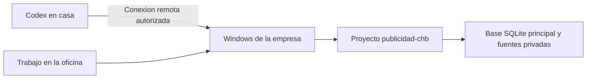

# Conectar casa y oficina — reunion del 28 de octubre de 2026

## Resultado que se busca

Usar el proyecto y la base principal en el Windows de la empresa desde ambos lugares. El Mac de casa accede al proyecto de ese Windows mediante Codex remoto. Las nuevas extracciones y revisiones se guardan en la misma base de la oficina. GitHub sigue conservando el codigo publico.

La conexion queda pendiente hasta emparejar los dispositivos y comprobar el acceso real. Usar la misma cuenta por si solo no copia las carpetas locales. El equipo central debe permanecer disponible para trabajar desde casa. No se ha configurado trabajo independiente sin conexion ni mezcla automatica de dos bases distintas.

## Lo preparado en el repositorio

`PREPARAR_OFICINA.cmd` y `scripts/prepare_office.py` preparan el entorno, ejecutan las pruebas, recuperan los originales si estan disponibles, comprueban la base y crean un respaldo privado con nombre nuevo. No sustituyen una base activa, no habilitan acceso remoto y no suben datos. Rechazan una base vacia o de demostracion como historico de la auditoria. La comprobacion del contenido real contra sus fuentes sigue correspondiendo al agente.

La preparacion deja el resultado bajo `private/reunion/`. El resultado indica expresamente que el emparejamiento sigue pendiente; no es una prueba de conexion.

## Mensaje para pegar en Codex del Windows de la empresa

> Prepara el proyecto de auditoria de Google Ads y Google Business para usarlo desde la oficina y desde el Mac de casa. Trabaja en este Windows, donde se genero la auditoria original. Clona https://github.com/Publicidadchb/publicidad-chb.git en una carpeta nueva si no existe un clon de ese repositorio; si ya existe, conserva todo, comprueba su remoto y actualizalo con git pull --ff-only solo si procede. Abre esa carpeta como proyecto local. Lee AGENTS.md y docs/REUNION_CASA_OFICINA.md. Ejecuta scripts/prepare_office.py con Python 3.10 o posterior; busca el interprete de Codex si Python no esta en PATH. Localiza y recupera la base historica y todas sus fuentes con los scripts existentes. Conserva los originales y los respaldos. Verifica integridad, evidencia, extracciones y procedencia; no confundas la demostracion con el historico. Usa este Windows como equipo central y private/chavez_auditoria.sqlite como base principal. No subas bases, fuentes, informes, credenciales ni datos privados a GitHub. Prepara la conexion remota nativa y deja para la persona presente las autorizaciones que requiera la aplicacion. Informa del nombre visible del equipo y proyecto, de si se recupero la base y de si la conexion esta realmente verificada. No declares terminado el emparejamiento sin una comprobacion desde casa.

Si el clon ya esta abierto, tambien se puede ejecutar `PREPARAR_OFICINA.cmd` con doble clic. El lanzador busca Python en el entorno del proyecto, en el runtime conocido de Codex y en PATH; no instala programas ni cambia opciones de seguridad.

## Emparejamiento durante la reunion

Segun la [documentacion oficial de OpenAI sobre conexiones remotas](https://learn.chatgpt.com/docs/remote-connections):

1. En el Windows, abrir la aplicacion de escritorio con la misma cuenta y espacio de trabajo. Ir a **Settings > Connections > Control this PC** e iniciar **Set up** o **Add**. La persona presente debe revisar el alcance y completar las autorizaciones solicitadas.
2. En el Mac de casa, abrir **Settings > Connections > Control other devices** y seguir el flujo que muestre la aplicacion para agregar el Windows. Los controles y la disponibilidad pueden variar. Completar los pasos de emparejamiento mostrados; no enviar codigos por el repositorio publico.
3. Dejar el Windows conectado, despierto y con la aplicacion abierta. Desde casa, seleccionar el Windows y su proyecto.

Si no aparece **Control other devices**, detener este procedimiento y comunicar las opciones visibles. La conexion SSH es una alternativa documentada, pero requiere una ruta privada de red y configuracion especifica. No esta configurada por esta entrega.

El acceso remoto puede permitir usar otros recursos del equipo segun los permisos concedidos; no se debe asumir que esta limitado a una carpeta. La persona responsable confirma ese alcance en la aplicacion. Los pasos de autenticacion, MFA o passkey se completan en su interfaz y no se guardan en archivos.

## Prueba de que ambos trabajan sobre el mismo proyecto

Desde el Mac, con el Windows seleccionado como lugar de ejecucion, pedir a Codex:

> Comprueba que estos comandos se ejecutan en el Windows de la empresa. Muestra el nombre del equipo, la carpeta del proyecto y el remoto Git. Ejecuta audit.py check con el Python de .venv sobre private/chavez_auditoria.sqlite. Muestra un resumen de integridad, extracciones, filas y revisiones sin revelar datos comerciales. Comprueba que coincide con el resumen privado generado en la oficina. Crea un archivo nuevo con un identificador de prueba en private/reunion/ y pide a la persona presente verificarlo en esa misma carpeta. No modifiques metricas para hacer la prueba.

La conexion se considera comprobada cuando se puede leer la base real desde casa ejecutando en el Windows y la persona de la oficina observa el mismo archivo de prueba. Ver la misma pagina de chat o la misma cuenta no basta para esa comprobacion.

## Trabajo posterior

- Usar el mismo proyecto del Windows y su base principal para las actualizaciones reales. Hacer un respaldo con nombre nuevo antes de cada importacion.
- Coordinar las acciones que usen el navegador o escritorio del Windows para que dos personas no manejen la misma pantalla a la vez.
- El Mac conserva su clon local para desarrollar y probar con datos ficticios. No escribir una segunda base historica independiente esperando que Git la mezcle despues.
- Git sincroniza el codigo segun docs/CONTINUAR_EN_CODEX.md. `private/` sigue fuera de Git. No colocar la base SQLite activa en una carpeta sincronizada como forma de resolver escrituras desde dos equipos.

## Estado al preparar esta guia

El codigo publico y la recuperacion local estan preparados. En el Mac de casa no esta la base historica original, y el Windows de la empresa no aparece entre los proyectos remotos disponibles. La herramienta de control de interfaz de esta sesion no permite abrir los ajustes de Codex. Por ello quedan pendientes la autorizacion local, el emparejamiento y la prueba real entre ambos equipos.
