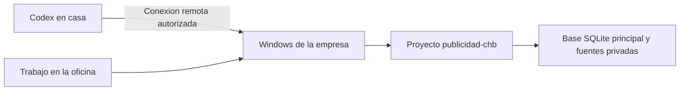

# Conectar casa y oficina — reunión del 28 de octubre de 2026

## Nota vigente — 30 de octubre de 2026

Esta guía conserva la propuesta de conexión remota del 28 de octubre como antecedente opcional. El usuario ha confirmado que recuperar la base original no es necesario para continuar. Conservar el PDF y los documentos existentes; se podrá hacer una nueva auditoría con acceso autorizado a Google Ads. Seguir primero [CONTINUAR_EN_CODEX.md](CONTINUAR_EN_CODEX.md). No ejecutar los pasos antiguos de recuperación o emparejamiento como requisitos automáticos, ni declarar sincronización sin comprobar el acceso a los archivos vigentes desde ambos equipos.

## Empezar aquí: guion para seguir juntos durante la reunión

Todo lo que puede prepararse desde casa está guardado en este repositorio. La recuperación real y la conexión se harán cuando la persona de la empresa esté delante del Windows. No es necesario que esa persona programe: puede pegar el mensaje del apartado siguiente en Codex.

Antes de empezar, tener ambos ordenadores con Internet, la aplicación de escritorio abierta y acceso a la misma cuenta de ChatGPT y al mismo espacio de trabajo. Mantener el Windows conectado a la corriente. El proyecto y las sesiones de Google de la oficina deben conservarse.

| Paso | Quién lo hace | Acción | Qué debe comprobarse antes de seguir |
| --- | --- | --- | --- |
| 1 | Persona de la oficina | Abrir Codex en el Windows donde se hizo la auditoría y abrir esta guía. | Es el equipo que contiene los originales; se ve la cuenta y el espacio de trabajo correctos. |
| 2 | Persona de la oficina | Pegar en Codex el **mensaje para el Windows** incluido más abajo. Esperar a que termine la preparación. | Codex localiza los originales, valida SQLite y muestra el respaldo creado. Si informa de un error, resolverlo allí antes de dar la base por recuperada. |
| 3 | Persona de la oficina | Abrir la carpeta clonada como proyecto local en Codex, si aún no aparece como tal. Comunicar en la reunión el nombre del equipo y del proyecto. | El proyecto apunta al clon preparado y contiene la base principal bajo `private/`; la demostración no se usa como histórico. |
| 4 | Persona de la oficina | En la aplicación, entrar en **Configuración / Settings → Conexiones / Connections → Controlar este PC / Control this PC** e iniciar la configuración que aparezca. Revisar y confirmar las autorizaciones en pantalla. | La aplicación permite conexiones al Windows y presenta el flujo de emparejamiento. |
| 5 | Persona de casa | En el Mac, entrar en **Configuración / Settings → Conexiones / Connections → Controlar otros dispositivos / Control other devices**. Agregar el Windows siguiendo el flujo visible en ambos equipos. | El Windows aparece como equipo accesible. Si esa opción no existe, seguir el apartado de incidencias. |
| 6 | Persona de casa | Seleccionar el Windows y el proyecto de auditoría como lugar de trabajo. Pegar el **mensaje de comprobación** de esta guía. | Los comandos se ejecutan en el Windows y leen la base recuperada. |
| 7 | Ambas personas | Comparar el resumen de validación y comprobar el mismo archivo de prueba bajo `private/reunion/`. | Desde casa se lee la base real y la persona de la oficina ve el archivo creado en ese Windows. Solo entonces dar la conexión por comprobada. |
| 8 | Ambas personas | Acordar que las actualizaciones reales se harán sobre ese proyecto del Windows, con respaldo previo a cada importación. | Los trabajos de casa y oficina quedan en la misma base principal. El Windows permanece disponible mientras se trabaja desde casa. |

## Si algún paso no coincide con la pantalla

- **No aparece “Controlar otros dispositivos”:** comunicar lo que se ve en Configuración → Conexiones. La disponibilidad depende de la aplicación y del espacio de trabajo. No dar por hecha una conexión alternativa; habrá que configurarla y comprobarla expresamente.
- **No encuentra la base original:** pedir a Codex de la oficina que localice `chavez_auditoria.sqlite` y la carpeta `auditoria_chavez` en ese Windows. Con la ruta comprobada, ejecutar el preparador con `--source`. Mantener los originales intactos.
- **Aparecen varias bases:** comparar procedencia y fechas con Codex, conservar todas y elegir explícitamente la principal. Una base vacía o de demostración no sirve como recuperación.
- **Se pierde la conexión:** comprobar que el Windows sigue encendido, con Internet y con la aplicación abierta. No continuar las importaciones sobre una copia distinta en casa.

El mensaje completo y las comprobaciones están a continuación. No hace falta habilitar acceso remoto antes de la reunión.

## Resultado que se busca

Usar el proyecto y la base principal en el Windows de la empresa desde ambos lugares. El Mac de casa accede al proyecto de ese Windows mediante Codex remoto. Las nuevas extracciones y revisiones se guardan en la misma base de la oficina. GitHub sigue conservando el codigo publico.

La conexion queda pendiente hasta emparejar los dispositivos y comprobar el acceso real. Usar la misma cuenta por si solo no copia las carpetas locales. El equipo central debe permanecer disponible para trabajar desde casa. No se ha configurado trabajo independiente sin conexion ni mezcla automatica de dos bases distintas.

## Lo preparado en el repositorio

`PREPARAR_OFICINA.cmd` y `scripts/prepare_office.py` preparan el entorno, ejecutan las pruebas, recuperan los originales si estan disponibles, comprueban la base y crean un respaldo privado con nombre nuevo. No sustituyen una base activa, no habilitan acceso remoto y no suben datos. Rechazan una base vacia o de demostracion como historico de la auditoria. La comprobacion del contenido real contra sus fuentes sigue correspondiendo al agente.

La preparacion deja el resultado bajo `private/reunion/`. El resultado indica expresamente que el emparejamiento sigue pendiente; no es una prueba de conexion.

## Mensaje para pegar en Codex del Windows de la empresa

> Prepara el proyecto de auditoria de Google Ads y Google Business para usarlo desde la oficina y desde el Mac de casa. Trabaja en este Windows, donde se genero la auditoria original. Clona https://github.com/Publicidadchb/publicidad-chb.git en una carpeta nueva si no existe un clon de ese repositorio; si ya existe, conserva todo, comprueba su remoto y actualizalo con git pull --ff-only solo si procede. Abre esa carpeta como proyecto local. Lee AGENTS.md y docs/REUNION_CASA_OFICINA.md. Ejecuta scripts/prepare_office.py con Python 3.10 o posterior; busca el interprete de Codex si Python no esta en PATH. Localiza y recupera la base historica y todas sus fuentes con los scripts existentes. Conserva los originales y los respaldos. Verifica integridad, evidencia, extracciones y procedencia; no confundas la demostracion con el historico. Usa este Windows como equipo central y private/chavez_auditoria.sqlite como base principal. No subas bases, fuentes, informes, credenciales ni datos privados a GitHub. Prepara la conexion remota nativa y deja para la persona presente las autorizaciones que requiera la aplicacion. Informa del nombre visible del equipo y proyecto, de si se recupero la base y de si la conexion esta realmente verificada. No declares terminado el emparejamiento sin una comprobacion desde casa.

Si el clon ya esta abierto, tambien se puede ejecutar `PREPARAR_OFICINA.cmd` con doble clic. El lanzador busca Python en el entorno del proyecto, en el runtime conocido de Codex y en PATH; no instala programas ni cambia opciones de seguridad.

## Emparejamiento durante la reunion

Segun la [documentacion oficial de OpenAI sobre conexiones remotas](https://learn.chatgpt.com/docs/remote-connections):

1. En el Windows, abrir la aplicacion de escritorio con la misma cuenta y espacio de trabajo. Ir a **Settings > Connections > Control this PC** e iniciar **Set up** o **Add**. La persona presente debe revisar el alcance y completar las autorizaciones solicitadas.
2. En el Mac de casa, abrir **Settings > Connections > Control other devices** y seguir el flujo que muestre la aplicacion para agregar el Windows. Los controles y la disponibilidad pueden variar. Completar los pasos de emparejamiento mostrados; no enviar codigos por el repositorio publico.
3. Dejar el Windows conectado, despierto y con la aplicacion abierta. Desde casa, seleccionar el Windows y su proyecto.

Si no aparece **Control other devices**, detener este procedimiento y comunicar las opciones visibles. La conexion SSH es una alternativa documentada, pero requiere una ruta privada de red y configuracion especifica. No esta configurada por esta entrega.

El acceso remoto puede permitir usar otros recursos del equipo segun los permisos concedidos; no se debe asumir que esta limitado a una carpeta. La persona responsable confirma ese alcance en la aplicacion. Los pasos de autenticacion, MFA o passkey se completan en su interfaz y no se guardan en archivos.

## Prueba de que ambos trabajan sobre el mismo proyecto

Desde el Mac, con el Windows seleccionado como lugar de ejecucion, pedir a Codex:

> Comprueba que estos comandos se ejecutan en el Windows de la empresa. Muestra el nombre del equipo, la carpeta del proyecto y el remoto Git. Ejecuta audit.py check con el Python de .venv sobre private/chavez_auditoria.sqlite. Muestra un resumen de integridad, extracciones, filas y revisiones sin revelar datos comerciales. Comprueba que coincide con el resumen privado generado en la oficina. Crea un archivo nuevo con un identificador de prueba en private/reunion/ y pide a la persona presente verificarlo en esa misma carpeta. No modifiques metricas para hacer la prueba.

La conexion se considera comprobada cuando se puede leer la base real desde casa ejecutando en el Windows y la persona de la oficina observa el mismo archivo de prueba. Ver la misma pagina de chat o la misma cuenta no basta para esa comprobacion.

## Trabajo posterior

- Usar el mismo proyecto del Windows y su base principal para las actualizaciones reales. Hacer un respaldo con nombre nuevo antes de cada importacion.
- Coordinar las acciones que usen el navegador o escritorio del Windows para que dos personas no manejen la misma pantalla a la vez.
- El Mac conserva su clon local para desarrollar y probar con datos ficticios. No escribir una segunda base historica independiente esperando que Git la mezcle despues.
- Git sincroniza el codigo segun docs/CONTINUAR_EN_CODEX.md. `private/` sigue fuera de Git. No colocar la base SQLite activa en una carpeta sincronizada como forma de resolver escrituras desde dos equipos.

## Estado al preparar esta guia

El codigo publico y la recuperacion local estan preparados. En el Mac de casa no esta la base historica original, y el Windows de la empresa no aparece entre los proyectos remotos disponibles. La herramienta de control de interfaz de esta sesion no permite abrir los ajustes de Codex. Por ello quedan pendientes la autorizacion local, el emparejamiento y la prueba real entre ambos equipos.
